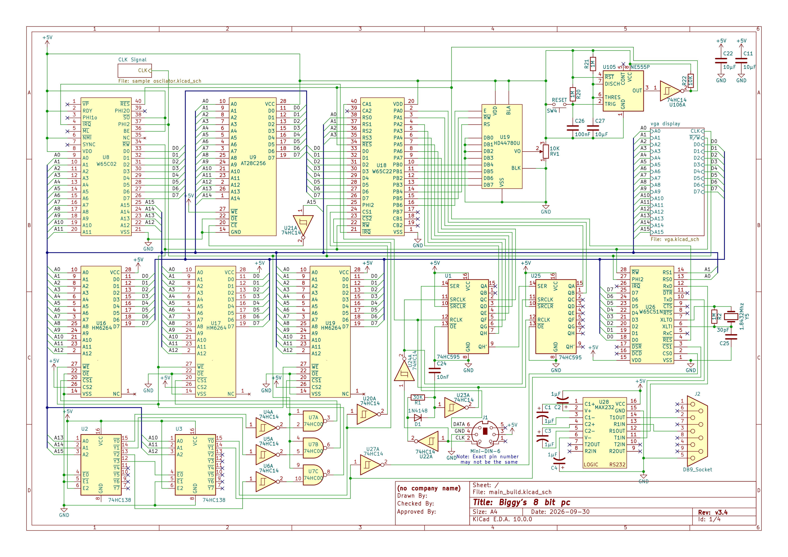

# Biggy's 6502 Computer
A passion project inspired by [Ben Eater](https://eater.net/)'s 6502 Computer project that I spent 1 year on with many original changes and additions from his design. All schematics and setup designs are drawn by me, this includes: the 8-bit computer, the eeprom programmer, the clock module, and the vga module. The project is currently under development so all schematics are not yet finalized; if there are any issues with the schematics please make an issue and I will look into it. Thanks for stopping by and trying out my build!

[View all schematics here](Schematics)

[View all code and programs used in the projects here](Software)