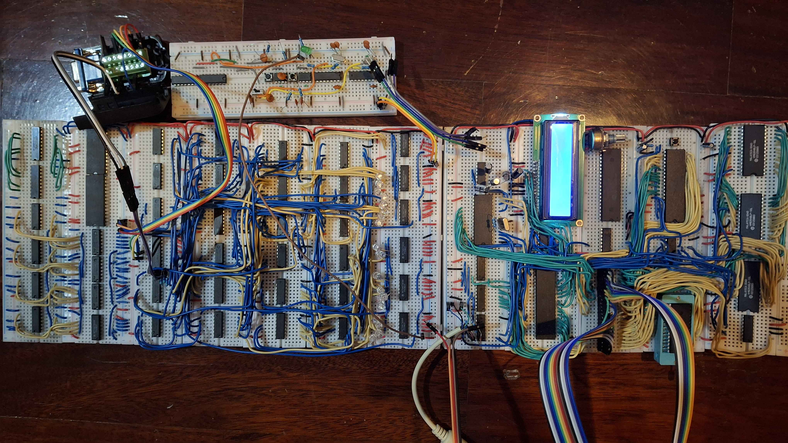
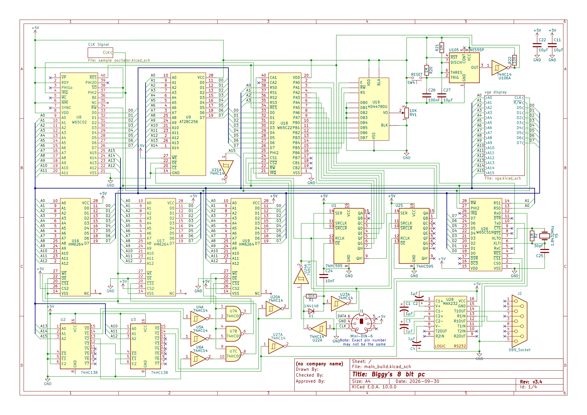

# Biggy's 6502 Computer
## A Custom 8-bit Computer with Graphics Based on the W65C02 Microprocessor
A custom 8-bit computer based on the W65C02S microprocessor, featuring an custom memory address architecture, clock system, peripherals, and a TTL-based VGA display.

## What is this?
This project is a custom-built 8-bit computer based on the W65C02 microprocessor, developed for nearly a year. Inspried by [Ben Eater's Computer](https://eater.net/6502), this projects adds new features onto the original design with a technical schematic, deep memory decoding, and graphics display.

The computer contains 24KB SRAM, 32KB EEPROM, 4/8 MHz clock module, RS232 serial communication, PS/2 keyboard input, LCD and 300x400 VGA graphics display, with an 8-bit sound synthesis under development. All schematics, assembly, python, and C++ code, are designed and developed for the project.

Currently, the system is functional but some parts remain under development.

# Key Specifications
## Memory Map
| Component | Range         |
| --------- | ------------- |
| RAM       | 0x0000-0x5FFF |
| VIA       | 0x6000-0x63FF |
| ACIA      | 0x6400-0x67FF |
| VGA       | 0x6800-0x6BFF |
| ROM       | 0x8000-0xFFFF |

[View all schematics here](Schematics)

[View all code and programs used in the projects here](Software)